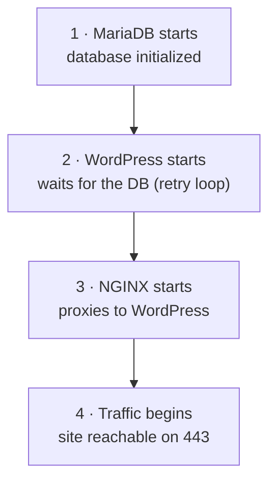
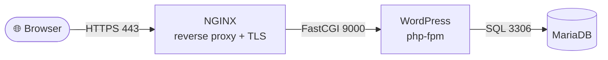

*This project has been created as part of the 42 curriculum by maria-ol.*

# 🐳 Inception

## 📖 Description

Inception is a System Administration project: it builds a small, production-like
infrastructure from scratch using Docker and Docker Compose, running inside a
virtual machine. A WordPress website is served over HTTPS, backed by a MariaDB
database, with each service isolated in its own container built from a custom
Dockerfile.

The design follows strict boundaries, one responsibility per container:

- **NGINX** handles external communication and TLS (the only public entry point)
- **WordPress** (php-fpm) handles the application logic
- **MariaDB** handles persistent data
- A **Docker network** handles internal communication between containers
- **Named volumes** handle persistence
- **PID 1** defines each container's lifecycle


## ⚙️ Instructions

### Requirements

A Linux VM with Docker Engine, the Docker Compose plugin, `make` and `git`.
The domain `maria-ol.42.fr` must point to localhost (see the
[DEV_DOC](./DEV_DOC.md) for full setup, including `.env` and secrets).

### Build & run

From the project root:

```bash
make        # build the images and start the whole stack
```

Then open **https://maria-ol.42.fr** in your browser.

Other useful targets:

```bash
make down    # stop and remove the containers
make clean   # stop everything and remove the volumes
make fclean  # clean + remove the host data folder and the images
make re      # full rebuild from scratch (fclean + up)
make status  # show containers, images, volumes and networks
make logs    # follow the logs of all containers
```


## 📦 Project Description

The whole stack is orchestrated with **Docker Compose**. Each service is built
from its own **Dockerfile** (no ready-made images), runs in a dedicated
container, and is wired together through a private Docker network and named
volumes. The `srcs/` folder holds the compose file and every service's build
context (its Dockerfile, config and init script).

### Boot order



Docker does not guarantee service *readiness* from start order alone, so
WordPress retries the database connection until it is ready, instead of relying
only on `depends_on`.

### Design choices

The main design decisions are compared below.

### Virtual Machines vs Docker

A **virtual machine** emulates a full computer: it runs a complete guest OS
(kernel included) on top of a hypervisor. That makes VMs heavy: gigabytes of
disk, slow to boot, costly in RAM and CPU.

A **container** shares the host's kernel and isolates only the application and
its dependencies. It is far lighter, megabytes instead of gigabytes, starts in
seconds, and runs many containers on the same machine.

For Inception, Docker is the right fit: each service (NGINX, WordPress, MariaDB)
runs in its own small, reproducible container, all orchestrated together, with
none of the overhead of running three separate virtual machines.

### Secrets vs Environment Variables

This project separates configuration into two layers, by sensitivity:

**Environment variables (`.env`)** hold the non-sensitive configuration the
stack needs to run: domain name, database name, usernames, site title, and
certificate fields. These values are not secret, so they can live in an `.env`
file. In some setups — a private repository under an organization with access
control — such non-sensitive config can even be versioned. Here, `.env` itself
stays git-ignored, and a versioned `.env.example` with descriptive placeholders
documents every variable so each developer can set up their own `.env` locally.

**Docker secrets (`secrets/`)** hold the sensitive values: the database root
password, the database user password, and the WordPress admin/user passwords.
Each secret is a separate file, mounted by Docker into the container at runtime
(under `/run/secrets/`) instead of being passed as an environment variable.

Why not just keep passwords in `.env`? Environment variables are easier to leak:
they show up in `docker inspect`, in process listings, and in child processes.
A mounted secret file is more contained and is never printed by those commands.
Secrets are **never versioned** and are **recreated locally** on each machine
(and provisioned securely in production) — they never travel through Git.

A side effect of doing this well: since no sensitive value lives in `.env`, the
`.env.example` ends up very close to the real `.env` — which is itself proof
that nothing secret is kept in the environment file.

### Docker Network vs Host Network

With a **Docker network** (a private virtual bridge), the containers communicate
in isolation from the host. They don't use localhost or physical IPs, they
resolve each other by container name: NGINX reaches WordPress at `wordpress:9000`
and WordPress reaches MariaDB at `mariadb:3306`, thanks to Docker's embedded DNS.

With **host networking**, containers share the host's network stack directly:
there is no isolation, and services are reached through the host's IP and ports.
This project uses a dedicated Docker network (host networking is forbidden by
the subject), which keeps the services isolated and lets only NGINX expose a
port to the outside.

### Docker Volumes vs Bind Mounts

**Named volumes** are storage managed by Docker itself. They preserve data
beyond the container lifecycle (a container can be destroyed and recreated while
its volume survives), they are listed and inspected with `docker volume`, and
they abstract away where the data physically sits.

**Bind mounts** map a specific host folder straight into the container. They are
simple but tie the setup to the host's filesystem layout, which hurts
portability and reproducibility.

The subject requires named volumes for the two persistent storages. This project
uses named volumes configured so their data lands in `/home/maria-ol/data/` on
the host: they stay managed Docker volumes (visible in `docker volume inspect`),
not plain bind mounts declared on the service.

## 📁 Project Structure

The full, commented directory tree is in the
[DEV_DOC](./DEV_DOC.md#2-project-structure).


## 🔄 Execution Flow

A request flows through the three layers, changing protocol at each hop:



NGINX terminates TLS and forwards `.php` requests to php-fpm; WordPress runs the
PHP and queries the database; MariaDB returns the data. Static files are served
by NGINX directly.


## 📚 Resources

### References and documentation

- [Persistence vs Ephemerality](https://www.youtube.com/watch?v=qr3tRJGkIS4) — Ephemeral vs Persistent Storage | System Design Tradeoffs

- [Medium Article - Inception 42](https://devabdilah.medium.com/inception-42-a-comprehensive-guide-to-dockerizing-your-first-infrastructure-part-i-bd7d4bdc13e6) — A Comprehensive Guide to Dockerizing Your First Infrastructure
- [DigitalOcean](https://www.digitalocean.com/community/tutorials/how-to-install-and-use-docker-on-ubuntu-20-04) — How To Install and Use Docker on Ubuntu
- [WordPress CLI](https://www.dreamhost.com/blog/guide-to-wp-cli/) — What Is the WordPress CLI
- [Aqua Security](https://www.aquasec.com/cloud-native-academy/docker-container/docker-networking/) — Docker Networking
- [DigitalOcean](https://www.digitalocean.com/community/tutorials/understanding-and-implementing-fastcgi-proxying-in-nginx) — Understanding and Implementing FastCGI Proxying in NGINX
- [Educative](https://www.educative.io/blog/docker-compose-tutorial) — Docker Compose Tutorial


### AI Usage

AI (Claude, by Anthropic) was used throughout this project as a
pair-programming and study aid. It helped with:

- **Understanding the concepts** before writing any code: the role of each
  service (NGINX as reverse proxy + TLS, php-fpm, MariaDB), how Docker
  networking and volumes work, PID 1 and the entrypoint lifecycle, and why
  each design choice matters.
- **Reviewing and explaining** the configuration files and scripts
  line by line, so every decision in the Dockerfiles, docker-compose.yml,
  setup scripts and Makefile is understood and can be justified.
- **Debugging**: reading container logs together to track down issues -> most
  notably the MariaDB first-run problem (the database was initialized during
  the image build, which prevented the init script from running on an empty
  volume) and the socket/permission setup.
- **Documentation**: structuring and reviewing the README, USER_DOC and
  DEV_DOC.

All scripts were implemented and debugged by hand by the student, with the AI acting as a review aid, debugging support, and study resource.
