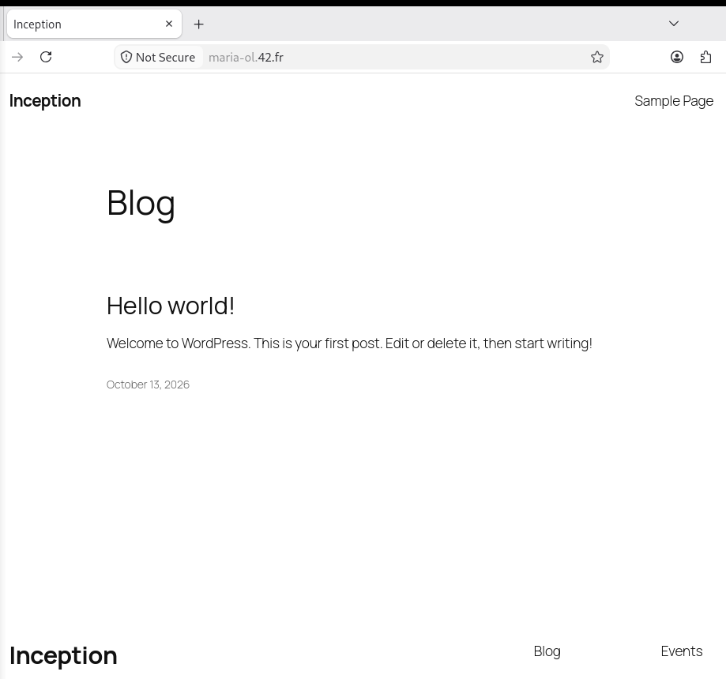
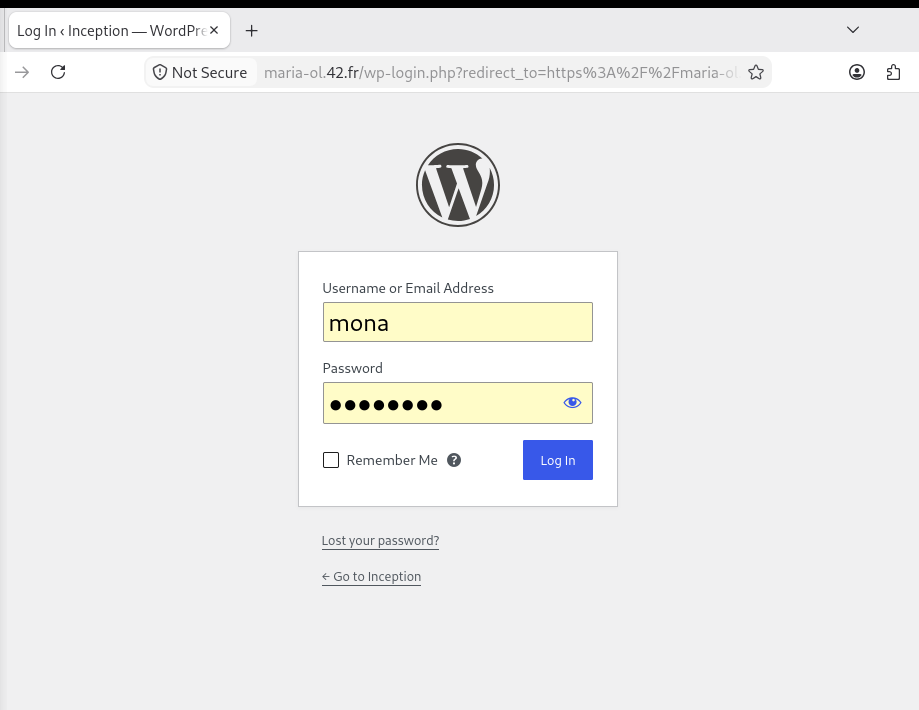
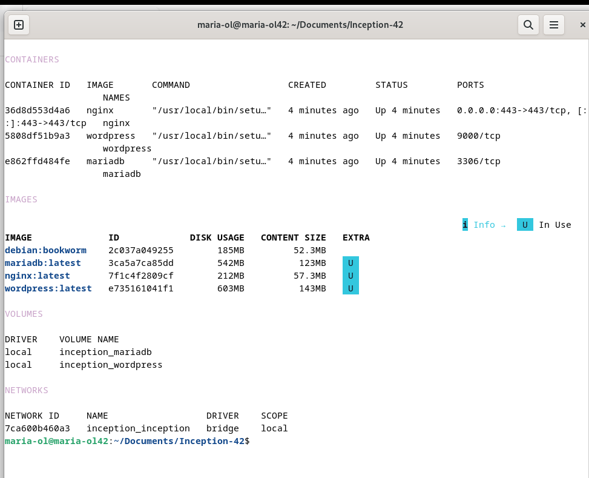

# USER_DOC — User Documentation

This guide explains how to use and manage the running Inception stack, without
going into development details.

## 1. What this stack provides

Inception runs a small WordPress website behind a secure web server. It is made
of three services, each in its own container:

- 🌐 **NGINX** — the web server and the only public entry point. It handles the
  secure (HTTPS) connection and forwards requests to WordPress.
- 📝 **WordPress** — the website itself: pages, posts, users and the admin panel.
- 🗄️ **MariaDB** — the database that stores everything WordPress needs.

Together they serve the website at **https://maria-ol.42.fr**.

## 2. Starting and stopping

From the project root:

```bash
make        # build and start the whole stack
make down   # stop and remove the containers
```

To pause the site temporarily without removing anything, and resume it later:

```bash
make stop    # pause the containers
make start   # resume them
```

> For the full list of commands (logs, status, cleanup, database access), see
> the [DEV_DOC](./DEV_DOC.md).

## 3. Accessing the website and admin panel

### The website

Open **https://maria-ol.42.fr** in your browser.

> The certificate is self-signed, so the browser shows a security warning the
> first time. This is expected — accept it to continue.



### The admin panel

The WordPress administration dashboard is available at
**https://maria-ol.42.fr/wp-admin**. Sign in with the administrator account
(see [Credentials](#4-credentials) below).



## 4. Credentials

The project uses two WordPress accounts:

| Account       | Username  | Role          |
|---------------|-----------|---------------|
| Administrator | `mona`    | Administrator |
| Regular user  | `visitor` | Author        |

Passwords are **not** stored in the repository. They live in separate files
under the `secrets/` folder, one password per file:

| File                            | Password for            |
|---------------------------------|-------------------------|
| `secrets/db_root_password.txt`  | MariaDB root user       |
| `secrets/db_password.txt`       | WordPress database user |
| `secrets/wp_admin_password.txt` | WordPress administrator |
| `secrets/wp_user_password.txt`  | WordPress regular user  |

To change a credential, edit the matching file (and, for usernames or emails,
the `srcs/.env` file), then rebuild the stack with `make re`.

> The `secrets/` folder and `.env` are never committed to git — they must be
> created locally on each machine.

## 5. Checking that the services are running

To see the state of all containers:

```bash
make status
```

All three containers (`nginx`, `wordpress`, `mariadb`) should be listed and
running. A healthy stack looks roughly like this:


Note that only `nginx` publishes a port to the host (`0.0.0.0:443->443`), while
`wordpress` and `mariadb` keep their ports internal to the Docker network.

If something looks wrong, follow the logs to see what is happening:

```bash
make logs
```

A quick end-to-end check: open **https://maria-ol.42.fr** — if the website
loads, all three services are working together (NGINX served the page,
WordPress built it, and MariaDB provided the data).
